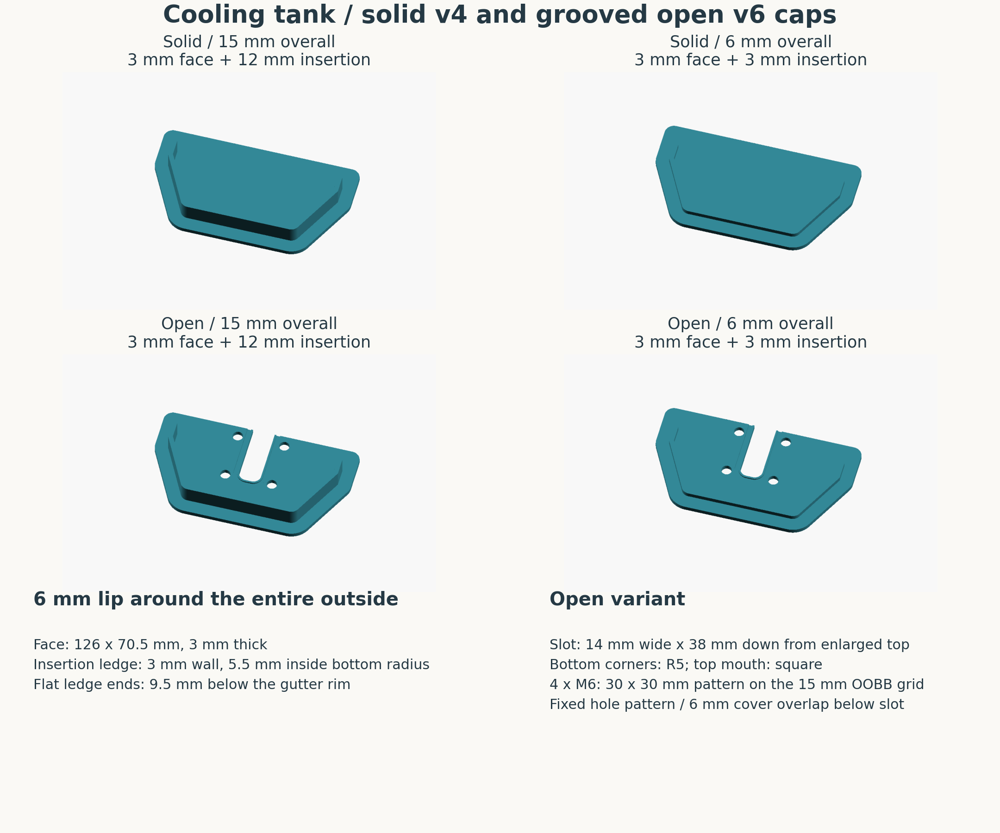
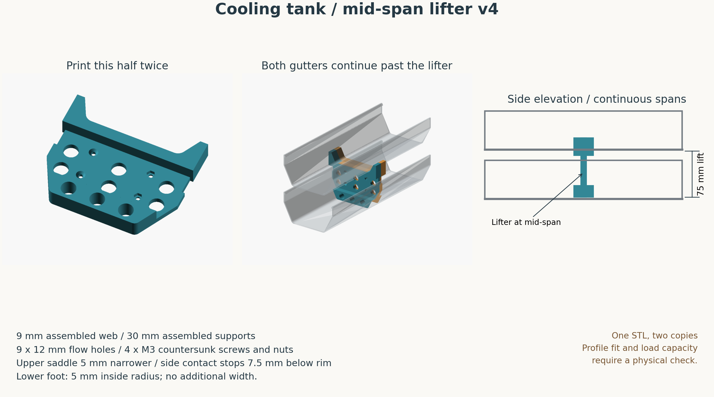

# Filament manufacturing cooling tank

## Current caps: solid version 4, grooved open version 6 and cover version 1

Both 6 mm and 15 mm caps now have a **6 mm outward lip around the entire
front plate**, including its top edge. The face is **126 x 70.5 x 3 mm**;
the insertion ledge retains the version 3 fit and its 3 mm wall thickness.
The approved version 4 lifter is unchanged.

The new **cap_end_open** variant has a central **14 mm-wide, 38 mm-deep**
opening measured down from the enlarged face's top edge. Its bottom corners
have the standard OOBB plate **5 mm radius**; the mouth has square corners.
The slot floor is raised 6 mm from version 4, giving a standard 44 x 44 mm
3 x 3 OOBB cover plate a 6 mm overlap below the opening. The four mounting
holes stay in their original positions. Four **M6 through-holes** occupy
the corners of a 3 x 3 OOBB grid centred 22 mm below the enlarged top: X = +/-15 mm, Y = 27.5 / 57.5 mm relative to the gutter's outside
bottom. This is a **30 x 30 mm pattern on a 15 mm grid**. OOBB's M6 primitive
supplies its 3D-print clearance (6.5 mm nominal bore diameter).

`CAP_FIT` and `CAP_OPENING` in populate define the dimensions. The slot uses
the OOBB `rounded_rectangle` primitive plus a square mouth extension; the
holes use `oobb_hole` with `radius_name="m6"`. The solid variant stays blank.
Version 3 cap definitions are preserved in
[version_3_cap_options.yaml](source_file/fit_trials/2026_11_17/version_3_cap_options.yaml).
The previous open caps are preserved in
[version_4_open_cap_options.yaml](source_file/fit_trials/2026_11_17/version_4_open_cap_options.yaml).
All ten active meshes pass verification, including actual through-cut and
rounded-bottom checks on the open caps. The four cap previews were rendered
from the generated SCAD. Physical fit of these new caps has not been tested.

## Cover plate and single-cord U seal

The **44 x 44 x 3 mm cover** uses the OOBB 3 x 3 plate primitive with **R5
outline corners, straight sidewalls and no face-edge rounding**. Only the four
M6 corner holes and the requested central M6 hole are included. The central
hole is an open port, located within the sealed region; fit the intended
fitting or plug there when a closed tank end is required.

[Cover STL](parts/three_d_print_filament_manufacture_cooling_tank_cap_cover_3_by_3_oobb_3_mm_thickness_version_1/3dpr.stl)
| [Cover SCAD](parts/three_d_print_filament_manufacture_cooling_tank_cap_cover_3_by_3_oobb_3_mm_thickness_version_1/3dpr.scad)
| [Assembly SCAD](preview/cap_seal_assembly.scad)


The cover and both version 6 open caps have matching **2.4 mm-wide U grooves,
0.8 mm deep per face**, with both ends exiting the top. Install **one length
of 2 mm OD rubber cord shared between the two grooves**, not a separate cord in
each groove. The faces meet directly: combined groove height is 1.6 mm,
giving **20% nominal cord squeeze** and approximately **81.8% gland fill**.
These are trial dimensions for unspecified cord material/hardness. Parker's
[O-Ring Handbook](https://www.parker.com/literature/O-Ring%20Division%20Literature/ORD%205700%20Parker_O-Ring_Handbook.pdf)
provides the static-seal squeeze and 60–85% gland-fill design guidance used
as a reference; it does not certify this printed open-ended seal.

There is **1.175 mm nominal land** between the straight slot sides and the
groove, and at the nearest M6 clearance holes. The groove's bottom edge has
**2.425 mm land to the cover's lower edge**. Both parts retain **2.2 mm of
plastic behind the grooves**. The existing **14 x 38 mm opening** and fixed
mounting pattern fit this seal, so no further slot-floor adjustment was needed.
The cord centreline is approximately **93.2 mm to the top**, before allowing
extra length for trimming the exposed ends.

The cap groove is on its **inside face**, at Z=3 mm beside the insertion
ledge. Install the cover inside the cap, flipping its groove toward that face.
The assembly preview shows the cover occupying Z=3 to 6 mm and verifies that
it clears the insertion ledge. These changes update the existing open-cap
version 6 and cover version 1 in place.

Print both pieces with their plain faces on the bed and grooves upward;
the cap ledge also points upward. Clean the grooves and trial-fit the cord
before assembly. The matching faces and grooves were checked in the actual exported
meshes; water sealing still needs a physical test.

`CAP_SEAL` and `CAP_COVER` in populate own the seal and cover parameters;
`get_cap_seal_geometry` defines the shared U path. The ungrooved version 5
open cap definitions remain reproducible in
[version_5_open_cap_options.yaml](source_file/fit_trials/2026_11_17/version_5_open_cap_options.yaml).

## Previous fit adjustment: lifter version 4 and cap version 3

The saddle opening is **5 mm narrower overall at both its bottom and top**
than lifter version 3: each inner side moves inward 2.5 mm throughout the
seating height. Its width allowance is now +3 mm relative to the nominal
profile, down from +8 mm. The nine flow holes and the lower-foot fit remain.

Both cap sizes now use a **5.5 mm inside bottom radius** (a 0.5 mm increase).
Their flat insertion-wall ends are **2 mm lower**, at Y=49 mm: **9.5 mm below
the gutter rim**. This is a cap-specific adjustment; the lifter lower-foot
radius stays 5 mm and its clip relief still starts 7.5 mm below the rim.
The cap front plates remain 3 mm thick and full height.

`CAP_FIT` in populate owns the cap radius and setback. The lifter's
`upper_saddle_width_extra_mm` sets its opening allowance. Previous versions
remain reproducible, including the saved definitions in
[source_file/fit_trials/2026_11_17](source_file/fit_trials/2026_11_17).
The historical revision notes below describe earlier fits; current download
links point to lifter v4, solid caps v4 and open caps v6. The user has approved the printed lifter fit.

## Version 3 riser: more water passages

The current lifter/riser has **nine 12 mm holes**, including six added through
the web. Print two identical copies of the current version_4 STL linked below. The
75 mm lift, 9 mm assembled web, 30 mm supports, revised corner fit, clip relief
and widened upper saddle are retained. Hole-row heights, diameters and X
positions are explicit multiline dictionaries in `web_flow_hole_rows` in
`working_oomp_populate.py`. Version 2 is preserved for comparison; the caps and
gutter reference parts remain at version 2; current caps are version 3.

## Version 2: adjustments after the first print

The first cap and lifter fit photos are saved in
[source_file/fit_trials/2026_11_16](source_file/fit_trials/2026_11_16).
The user selected **10 mm inside corner diameter**, which is **5 mm radius**
(previously 4.75 mm). With the 2.25 mm gutter wall, the outside bottom radius
is now 7.25 mm. This is a selected trial dimension, not a measurement extracted
from the angled photographs. Width, height, wall thickness and shoulder position
remain unchanged.

- **Both caps:** the 3 mm insertion wall has plain, flat ends **7.5 mm below
  the gutter top**, at Y=51 mm. It no longer follows or catches the top clips.
  The full 58.5 mm-high solid front face remains 3 mm thick.
- **Lifter lower foot:** the same 5 mm inside-radius correction, with no added
  width. Side contact ends at Y=51 mm. Above this point a straight 104.5 mm-wide
  neck provides 0.5 mm clearance per side from the estimated clip tips. It
  widens back out at the upper shoe, above the lower gutter rim.
- **Lifter upper saddle:** the seating opening is **8 mm wider overall**,
  4 mm on each side, at the same 75 mm bottom-to-bottom seat height. This is
  a horizontal expansion of the seating contour; it does not widen the lower
  foot or change the 30 mm axial support depth. It preserves the corner curves.

The original seven `version_1` definitions are preserved in
[version_1_options.yaml](source_file/fit_trials/2026_11_16/version_1_options.yaml)
and still regenerate their original geometry. Current links below point to
`version_2`. `FIT_REVISION` in populate owns the diameter and top setback;
`upper_saddle_width_extra_mm` owns the lifter's additional seating width.

FloPlast square gutter tank with solid and open printed end caps and an identical-half lifter. All dimensions are
millimetres. The caps butt against the cut end: their flanged front face is
3 mm thick, with a 3 mm thick U-shaped insertion ledge following the sides and
base. The solid cap closes the section; the open variant provides a top opening and mounting holes.



| Variant | Cap overall depth | Front plate | Insertion depth | STL | Editable SCAD |
| --- | --- | --- | --- | --- | --- |
| Solid | 15 mm | 3 mm | 12 mm | [15 mm STL](parts/three_d_print_filament_manufacture_cooling_tank_cap_end_solide_15_mm_depth_version_4/3dpr.stl) | [SCAD](parts/three_d_print_filament_manufacture_cooling_tank_cap_end_solide_15_mm_depth_version_4/3dpr.scad) |
| Solid | 6 mm | 3 mm | 3 mm | [6 mm STL](parts/three_d_print_filament_manufacture_cooling_tank_cap_end_solide_6_mm_depth_version_4/3dpr.stl) | [SCAD](parts/three_d_print_filament_manufacture_cooling_tank_cap_end_solide_6_mm_depth_version_4/3dpr.scad) |
| Open + M6 holes | 15 mm | 3 mm | 12 mm | [15 mm STL](parts/three_d_print_filament_manufacture_cooling_tank_cap_end_open_15_mm_depth_version_6/3dpr.stl) | [SCAD](parts/three_d_print_filament_manufacture_cooling_tank_cap_end_open_15_mm_depth_version_6/3dpr.scad) |
| Open + M6 holes | 6 mm | 3 mm | 3 mm | [6 mm STL](parts/three_d_print_filament_manufacture_cooling_tank_cap_end_open_6_mm_depth_version_6/3dpr.stl) | [SCAD](parts/three_d_print_filament_manufacture_cooling_tank_cap_end_open_6_mm_depth_version_6/3dpr.scad) |

Print with the flat exterior face on the bed (already at Z=0), ledge upward.
There are no penetrations, mounting holes or top crossbar in the ledge.

## Identical-half lifter

This is a **mid-span support**. Both gutter lengths continue past it in both
directions; it does not close either gutter end. The three lower flow passages
connect the water on either side of the support. The assembly view uses two
300 mm gutter segments with the lifter at their midpoint.

[Print STL](parts/three_d_print_filament_manufacture_cooling_tank_lifter_75_mm_lift_height_9_mm_thickness_30_mm_support_thickness_version_4/3dpr.stl)
· [Editable SCAD](parts/three_d_print_filament_manufacture_cooling_tank_lifter_75_mm_lift_height_9_mm_thickness_30_mm_support_thickness_version_4/3dpr.scad)
· [Exploded assembly](parts/three_d_print_filament_manufacture_cooling_tank_lifter_75_mm_lift_height_9_mm_thickness_30_mm_support_thickness_version_4/assembly_exploded.scad)
· [Mid-span assembly](parts/three_d_print_filament_manufacture_cooling_tank_lifter_75_mm_lift_height_9_mm_thickness_30_mm_support_thickness_version_4/assembly_mid_span.scad)



Print **two copies of the same STL**, flat joining face down. Each print has a
4.5 mm web and 15 mm axial support depth. Rotate the second copy 180 degrees
about its upright Y axis and join the flat faces at Z=0; do not mirror the STL
in the slicer. The assembled web is **9 mm** thick and both bearing shoes are
**30 mm** deep along the gutter. The completed lifter spans 109.5 mm across the
gutter and 90.75 mm vertically, including its raised saddle sides.

The **75 mm lift** is interpreted as **outside bottom of lower gutter to outside
bottom of upper gutter**, not a 75 mm clear gap. The lower bearing contacts the
inside base at Y=2.25 mm; the upper seat contacts the upper gutter's outside
base at Y=75 mm. The upper gutter sits 16.5 mm above the lower gutter's rim.
Its curved lower sides are supported by the saddle's 18 mm raised ends.

Nine **12 mm diameter flow passages** align through both halves. The original
three lower-shoe passages remain on 24 mm centres, with their lower edges 3 mm
above the gutter inside base. Six additional web passages sit at X=-40, 0 and
40 mm in two rows at Y=32 and 50 mm, measured from the lower gutter outside
base. They avoid the bearing shoes and fasteners and retain at least 3 mm of
material at the web outline. The total nominal open area is approximately
1018 mm², three times the original 339 mm² when fully submerged; this is an
area comparison, not a measured flow-rate increase. These are flow passages,
not complete-drainage notches.

Each half has two left-hand M3 countersinks and two right-hand M3 nut pockets,
at X=±24 mm and Y=33/56 mm. Turning the second copy swaps left and right so
every countersink faces a nut pocket. Use **four M3 countersunk screws and four
M3 hex nuts**. A nominal 10 mm countersunk screw extends approximately 1 mm
beyond the 9 mm assembled web. Heads and nuts remain accessible from opposite
outer faces between the shoes. Tighten the assembly and position it at mid-span
inside the lower gutter, then seat the upper gutter so it continues across the
support. Version 2 clears the clip region rather than engaging it; the lower
profile remains a nominal zero-clearance fit and needs a new physical trial.

The holes are generated with `oobb_screw_countersunk`, `oobb_hole` and
`oobb_nut`, using the installed OOBB M3 dimensions. In the print mode these
give a 3.6 mm shaft clearance, 7.2 mm countersink mouth, 1.9 mm countersink
depth and approximately 6 mm across-flats × 3 mm deep nut pockets. The nut
depth is resolved separately per output mode to avoid inherited part-depth or
legacy mixed-mode defaults.

Declare additional sizes in `LIFTER_VARIANTS` in `working_oomp_populate.py`:

```python
LIFTER_VARIANTS = [
    {
        "lift_height_mm": 75.0,
        "thickness_mm": 9.0,
        "support_thickness_mm": 30.0,
    },
]
```

The dimensions are assembled values. Adding another dictionary generates its
own part and taxonomy through the usual pipeline. Secondary dimensions such
as shoe height, flow-hole diameter/pitch and screw placement are also explicit
populate assignments. Geometry rejects sizes that collide with the gutters,
leave too little material around fasteners, or make overlapping flow ports.
The minimum web thickness is 8 mm to retain material below the nut pockets.

Regenerate this family with:

```powershell
python -c "import action_make_scad; action_make_scad.main(filter='lifter')"
python action_preview_lifter.py
python action_verify_cooling_tank.py
```

The assembly SCAD and overview are generated by `action_preview_lifter.py`;
the mid-span assembly bundles a short local gutter reference include. Its two colours
represent identical copies, not different printable parts. Nominal model fit
has zero interference with either gutter. Actual fit inherits the profile
estimates described below; physical fit and load capacity remain untested.

## Profile basis and physical fit

- [Manufacturer's supplied drawing](https://www.floplast.co.uk/uploads/product-images/thumbs/TzthwyEyd4jlruupRya4q3cotOfUAovxlqG51iY3.jpg): **114 mm wide × 58.5 mm high, external**. A local copy is saved in [source_file/floplast](source_file/floplast/square_gutter_profile.jpg).
- [Product identification](https://www.screwfix.com/p/floplast-rgs3w-upvc-square-gutter-white-114mm-x-3m/28154): FloPlast RGS3W, white uPVC square gutter, 3 m stock length. No price, supplier catalogue or additional sourcing research is included.
- **2.25 mm nominal gutter wall**: user-supplied measurement. It is applied as a perpendicular inward offset, including the slopes and corners; the small bead adds local thickness at the top lips.
- **Estimated from the raster**, not dimensioned by the manufacturer: 37.5 mm shoulder height; 75 mm width between virtual bottom corners; 3 mm external shoulder radius; 2 mm inward lip projection over the top 5 mm, with its tip 4 mm below the top. Version 2's 7.25 mm external bottom radius comes from the user's 10 mm inside diameter plus wall thickness. The actual straight base is shorter than the virtual corner width because of the fillets.
- Circular arcs use at most 1 degree per segment (less than 0.0003 mm outer chord deviation at radius 7.25 mm).

The ledge follows this reconstructed inner profile at **zero nominal clearance**.
It matches the reference gutter model; a perfect physical match cannot be
established from this low-resolution drawing alone. Measure a real cut end and
trial-fit the 6 mm cap before committing to the longer cap. `fit_clearance_mm`
can be increased to provide a perpendicular gap, while retaining a 3 mm ledge
wall. A closed STL is not proof of a watertight print or joint; water sealing has
not been tested.

## Gutter part entries

Each entry contains metadata, a matching cross-section extruded to its actual
length, SCAD, STL and a PNG. These are reference parts for the purchased/cut
gutter, not instructions to print a 3 m channel. “3000 m” was interpreted as
3000 mm in the request.

- [3000 mm](parts/three_d_print_filament_manufacture_cooling_tank_gutter_square_114_mm_width_3000_mm_length_version_2/working.yaml)
- [1000 mm](parts/three_d_print_filament_manufacture_cooling_tank_gutter_square_114_mm_width_1000_mm_length_version_2/working.yaml)
- [500 mm](parts/three_d_print_filament_manufacture_cooling_tank_gutter_square_114_mm_width_500_mm_length_version_2/working.yaml)
- [300 mm](parts/three_d_print_filament_manufacture_cooling_tank_gutter_square_114_mm_width_300_mm_length_version_2/working.yaml)

## Persistent sources and rebuild

Change defaults and variants in [working_oomp_populate.py](working_oomp_populate.py).
Change geometry in [working_scad.py](working_scad.py), specifically
`get_gutter_sections`, `get_cap_sections`, `get_cap_end_solide`,
`get_cap_end_open`, `get_cap_cover`, `get_cap_seal_geometry` and `get_gutter_square`.
Avoid changing generated `working.yaml` files as the sole source of an edit.

```powershell
python action_make_scad.py
python action_verify_cooling_tank.py
python action_preview_cooling_tank.py
python action_preview_cap_seal.py
python action_preview_lifter.py
python -m unittest discover -s tests -v
```

The existing populate → `parts_source` → `working_oomp` → `parts` →
`working_scad` pipeline writes ten current entries plus seven preserved first-print
entries, previous solid cap version_2/version_3 and open cap version_4/version_5 entries and previous lifter version_2/version_3 entries and refreshes taxonomy navigation.
Solid caps and the lifter are version_4; open caps are version_6; the cover is version_1; gutter entries remain version_2.
To rebuild the cap family, use `python -c "import action_make_scad; action_make_scad.main(filter='cap_end')"`.
The SCAD action waits for OOMP materialization before reading the part files.
The catalogue and geometry depend on the existing local OOMP/OOBB environment
plus Shapely; verification uses NumPy and trimesh, and the overview uses
Matplotlib. SCAD/STL is enabled; native SolidCraft is explicitly disabled for
these parts. Each generated SCAD bundles its polygon coordinates and can be
opened directly in OpenSCAD without Shapely or the Python project.

The inherited generic `save_type=all` exporter also attempts SVG/DXF on 3D
objects, which OpenSCAD rejects as non-2D. Those formats are not deliverables;
SCAD, STL and PNG outputs are verified separately.

Taxonomy:

```text
three_d_print / filament_manufacture / cooling_tank
  cap_end_solide / {15,6}_mm_depth / version_4
  cap_end_open / {15,6}_mm_depth / version_6
  cap_cover / 3_by_3_oobb / 3_mm_thickness / version_1
  gutter_square / 114_mm_width / {3000,1000,500,300}_mm_length / version_2
  lifter / 75_mm_lift_height / 9_mm_thickness / 30_mm_support_thickness / version_4
```

`cap_end_solide` retains the requested spelling. The geometry checks cover
symmetry, perpendicular wall thickness on base/slope/vertical/curve, zero model
interference, an open-top ledge, fit allowance, catalogue identity and invalid
parameters. [Mesh verification](verification/cooling_tank_meshes.json) checks all
ten active exported STLs for dimensions, positive volume, one connected body, closure,
consistent winding and agreement with the calculated cross-section volumes.
Lifter checks additionally probe the actual mesh for clear bores, recess depths,
web/shoe thicknesses and aligned holes after the identical-copy half-turn.
The test suite includes a separately declared 90/12/40 mm lifter variant.
Cap checks also verify the 6 mm normal flange offset, unchanged insertion ledge,
OOBB cutter selection, hole layout and clear slot/bores in the actual meshes.
