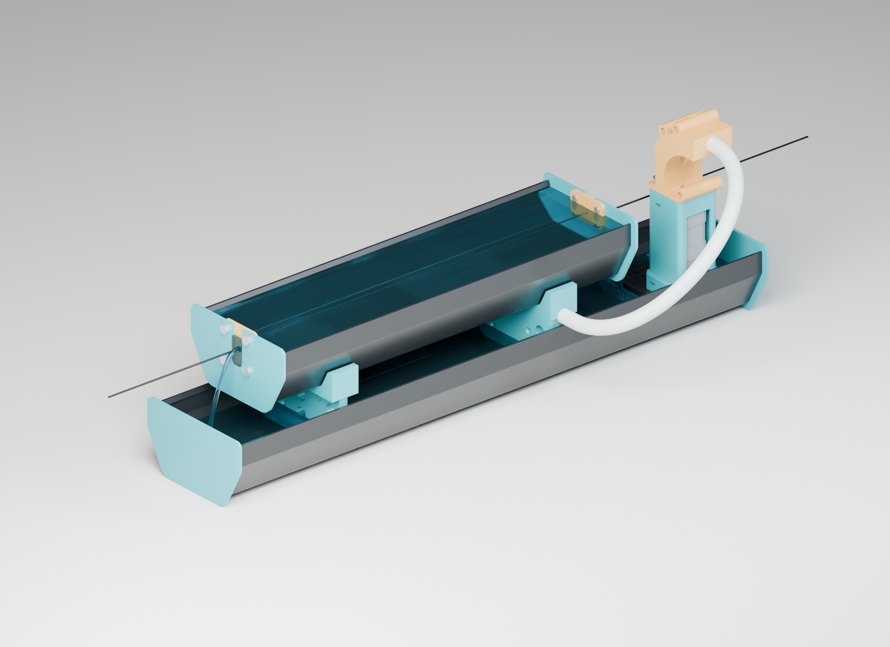

# Filament manufacturing cooling tank

A two-level filament-cooling tank made from 114 mm square uPVC guttering and
parametric printed caps, covers and identical-half lifters. The upper trough
cools a continuous filament; water drains through its end-cover holes into the
longer lower reservoir. The rear reservoir space is reserved for a future pump.

[Full-size render](demonstration/cooling_tank_render.png)

## AI-created and available to adapt

This project was largely designed, coded and documented with AI, guided by
physical print-and-fit testing. The files are here for anyone who would like
to download the project and ask their own AI to modify it for their setup.

See the [code, modification and rebuild guide](BUILD_AND_MODIFY.md) for the
source files and instructions.

## Demonstration assembly

| Feature | Arrangement |
| --- | --- |
| Lower trough | **600 mm**, black guttering, solid cap at each end |
| Upper trough | **400 mm**, black guttering, slotted cap and inside cover at each end |
| Height | **75 mm** outside-bottom to outside-bottom; 16.5 mm gap between lower rim and upper bottom |
| Rear extension | **100 mm added only at the rear**; front and upper-trough positions unchanged |
| Exposed reservoir | 50 mm ahead of the upper trough and **150 mm behind it**, including the additional 100 mm pump space |
| Supports | Two mid-span lifters, each assembled from two identical prints |
| Water | Lower trough half its internal depth; upper water surface 5 mm below its rim |
| Filament | **1.75 mm diameter, black**, continuous through both central M6 holes and the upper water, extending beyond both ends |

The render uses the actual current CAD meshes. The upper end arrangement is
repeated at both ends to provide a continuous filament path. Gold covers are
installed **inside** the teal caps. The water streams and ripples illustrate
flow; this is not a fluid simulation. A pump, return hose and incoming feed
needed to maintain the upper water level are not shown. The pump bay is empty.

## Parts and print files

The catalogue contains **ten current parts with unversioned names**. The files
below are the latest designs; older part versions have been removed.

| Printed part | Options | STL |
| --- | --- | --- |
| Solid end cap | 15 mm total / 12 mm insertion | [15 mm](parts/three_d_print_filament_manufacture_cooling_tank_cap_end_solide_15_mm_depth/3dpr.stl) |
| Solid end cap | 6 mm total / 3 mm insertion | [6 mm](parts/three_d_print_filament_manufacture_cooling_tank_cap_end_solide_6_mm_depth/3dpr.stl) |
| Slotted end cap, inside seal groove | 15 mm total / 12 mm insertion | [15 mm](parts/three_d_print_filament_manufacture_cooling_tank_cap_end_open_15_mm_depth/3dpr.stl) |
| Slotted end cap, inside seal groove | 6 mm total / 3 mm insertion | [6 mm](parts/three_d_print_filament_manufacture_cooling_tank_cap_end_open_6_mm_depth/3dpr.stl) |
| Grooved 3 x 3 cover | 44 x 44 x 3 mm | [Cover](parts/three_d_print_filament_manufacture_cooling_tank_cap_cover_3_by_3_oobb_3_mm_thickness/3dpr.stl) |
| Identical lifter half | 75 mm lift / 9 mm web / 30 mm shoes, assembled | [Half — print two per support](parts/three_d_print_filament_manufacture_cooling_tank_lifter_75_mm_lift_height_9_mm_thickness_30_mm_support_thickness/3dpr.stl) |

The other four entries are gutter-reference lengths of 3000, 1000, 500 and
300 mm. The demonstration cuts the same section to 600 and 400 mm; those lengths
are assembly dimensions rather than additional printable parts.

For the illustrated assembly, use:

- One 600 mm and one 400 mm gutter length.
- Two 15 mm solid caps and two 15 mm slotted caps.
- Two cover plates and four identical lifter halves.
- Eight M3 countersunk screws and nuts for the two lifters.
- Eight M6 corner fasteners with suitable nuts/washers for the upper covers.
- Two lengths of **2 mm OD rubber cord**, approximately 93.2 mm each along the
  U centreline, plus allowance for trimming the ends.

## Cap and cover geometry

The 3 mm front plate has a **6 mm outward lip** around the gutter outline,
including the top: its overall face envelope is **126 x 70.5 mm**. The insertion
ledge is a 3 mm U-shaped wall. Its inside bottom radius is 5.5 mm, and its flat
wall ends stop 9.5 mm below the gutter rim to clear the complicated top clips.

The central opening is **14 mm wide and 38 mm deep**, measured from the enlarged
plate's top edge. Its lower corners are R5 and its top mouth is square. Four M6
holes occupy the corner positions of a **3 x 3 OOBB grid**: a 30 x 30 mm pattern
on 15 mm spacing, centred 22 mm below the enlarged top edge.

The cover uses the OOBB 3 x 3 plate primitive with **R5 outline corners and
straight sidewalls**, with no face-edge rounding. It has exactly five holes:
the four corner M6 holes and one central M6 hole. OOBB's current 3D-print M6
clearance is 6.5 mm nominal diameter; the centre hole stays open around the
1.75 mm filament in this demonstration.

## Inside U seal

Both mating faces have a top-open U groove for **one shared 2 mm rubber cord**.
The cap groove is on its inside face, beside the insertion ledge. Install the
cover inside the cap with its groove facing this surface. The flat faces meet
at Z=3 mm in cap coordinates; the cover occupies Z=3 to 6 mm and clears the ledge.

Each groove is **2.4 mm wide x 0.8 mm deep**. Together they give 1.6 mm gland
height, **20% nominal cord compression** and approximately 81.8% gland fill.
There is 1.175 mm nominal land beside the slot and nearest M6 clearance hole,
2.425 mm below the groove to the cover edge, and 2.2 mm material behind each
groove. The cord's two ends exit the top. These are trial dimensions for the
chosen cord; physical water sealing has not yet been tested.

The [Parker O-Ring Handbook](https://www.parker.com/literature/O-Ring%20Division%20Literature/ORD%205700%20Parker_O-Ring_Handbook.pdf)
was used as a reference for static squeeze and gland fill, not as certification
of the printed open-ended seal.

Print both the cap and cover with their plain face on the bed and grooves
upward. The cap ledge points upward. Clean the grooves before assembly.

## Mid-span lifter

The lifter sits inside the lower gutter and supports the upper gutter **75 mm
higher**, measured between outside bottoms. Its assembled web is 9 mm thick;
the lower and upper supporting shoes extend to 30 mm along the gutter.

Print two copies of the same half flat, then turn the second half 180 degrees
about its upright axis and join the flat faces. The four M3 countersinks and
nut pockets swap sides and align. Three lower holes and six web holes, all
12 mm diameter, allow water to pass the support. Lower-foot inside radius is
5 mm; side contact stops 7.5 mm below the lower rim to clear the clips. The
upper saddle has a 3 mm width allowance over the nominal gutter profile.
The lifter's printed fit has been accepted after trial fitting.

## Dimensions and verification

The gutter profile is based on the [FloPlast drawing](source_file/floplast/square_gutter_profile.jpg)
and a supplied **2.25 mm wall thickness**: 114 mm external width and 58.5 mm
external height. Undimensioned profile features were reconstructed and refined
from the [printed fit photographs](source_file/fit_trials/2026_11_16).
The black material in the demonstration uses that same section.

The lifter has been physically trial-fitted. Digital geometry checks pass for
the current parts; cooling performance, flow rate, structural load capacity
and water sealing still need physical testing.
