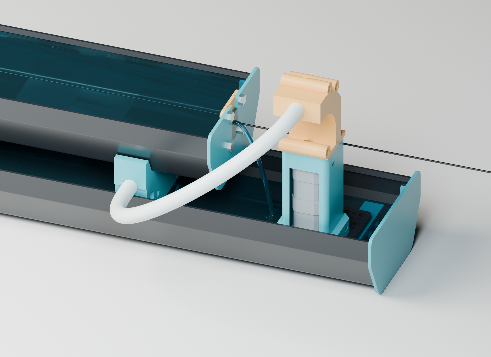
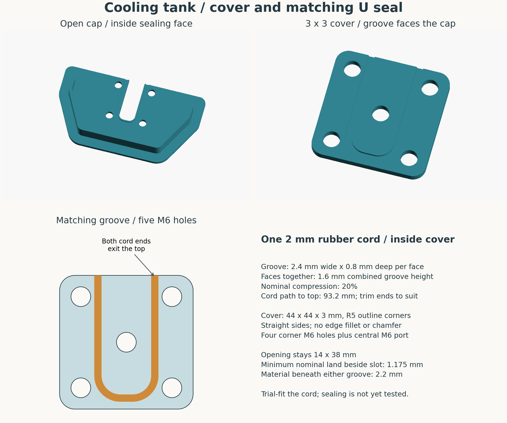
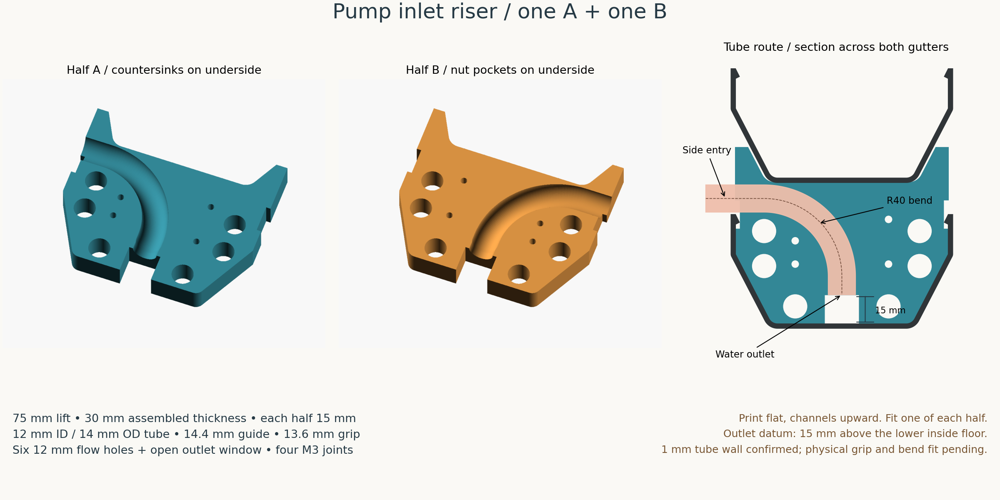
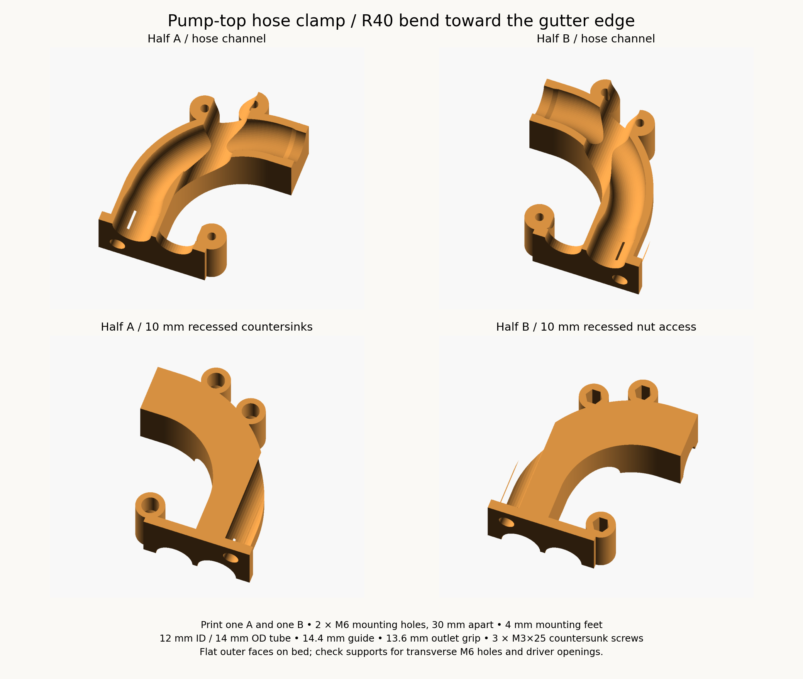
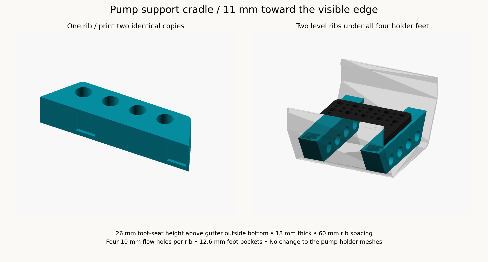

# Filament manufacturing cooling tank

A two-level filament-cooling tank made from 114 mm square uPVC guttering and
parametric printed caps, covers and lifters. The upper trough
cools a continuous filament; water drains through its end-cover holes into the
longer lower reservoir. The rear bay holds a JT-500 pump in its printed holder,
with a silicone hose leading to the rear pump-inlet riser.

[Full assembly render](demonstration/cooling_tank_render.png) ·
[Rear pump and hose close-up](demonstration/pump_hose_detail.png)

## AI-created and available to adapt

This project was largely designed, coded and documented with AI, guided by
physical print-and-fit testing. The files are here for anyone who would like
to download the project and ask their own AI to modify it for their setup.

See the [code, modification and rebuild guide](BUILD_AND_MODIFY.md) for the
source files and instructions.

## Demonstration assembly

| Feature | Arrangement |
| --- | --- |
| Lower trough | **600 mm**, black guttering, solid cap at each end |
| Upper trough | **400 mm**, black guttering, slotted cap and inside cover at each end |
| Height | **75 mm** outside-bottom to outside-bottom; 16.5 mm gap between lower rim and upper bottom |
| Rear extension | **100 mm added only at the rear**; front and upper-trough positions unchanged |
| Exposed reservoir | 50 mm ahead of the upper trough and **150 mm behind it**, including the additional 100 mm pump space |
| Supports | Original identical-half lifter at the front; pump-inlet halves A and B at the rear |
| Pump and hose | JT-500 holder shifted 11 mm on two level cradle ribs; pump centre 26 mm toward the visible edge; an M6-mounted R40 clamp turns the 12 mm ID / 14 mm OD hose outward into the rear riser |
| Water | Lower trough half its internal depth; upper water surface 5 mm below its rim |
| Filament | **1.75 mm diameter, black**, continuous through both central M6 holes and the upper water, extending beyond both ends |

The render uses the actual current CAD meshes. The upper end arrangement is
repeated at both ends to provide a continuous filament path. Gold covers are
installed **inside** the teal caps. The water streams and ripples illustrate
flow; this is not a fluid simulation. The illustrated pump hose discharges into
the **lower trough**, 15 mm above its inside floor. A separate feed to maintain
the upper water level is not shown. The half-full lower water level remains an
illustration rather than an operating submersion specification for the pump.

The close-up shows the **12 mm ID / 14 mm OD hose** captured by the gold R40
clamp on the pump top and its side entry into the rear riser. Inside the riser, the hose bends downward
to the outlet 15 mm above the lower gutter's inside floor.

The holder uses the existing JT-500 project's actual base, top and retaining lid meshes, with
its nominal pump reference. It sits upright in the rear bay, centred 65 mm
ahead of the gutter's rear end. The hose fits over the pump's nominal outlet,
turns toward the visible edge and passes continuously through the rear riser.
The pump sits 15 mm off the base centre, making the top flush with the edge
of the 5×5 base. The pump follows the holder’s current inward-facing outlet orientation. The bender turns the hose back toward the visible edge, while the cradle shifts the complete holder another 11 mm outward.
The holder's pump fit and the hose connection still need physical checking.

[Pump-holder base STL](source_file/pump_holder/base.stl) ·
[Pump-holder top STL](source_file/pump_holder/top.stl) ·
[Pump-holder lid STL](source_file/pump_holder/lid.stl)

## Parts and print files

The catalogue contains **thirteen current parts with unversioned names**. The files
below are the latest designs; older part versions have been removed.

| Printed part | Options | STL |
| --- | --- | --- |
| Solid end cap | 15 mm total / 12 mm insertion | [15 mm](parts/three_d_print_filament_manufacture_cooling_tank_cap_end_solide_15_mm_depth/3dpr.stl) |
| Solid end cap | 6 mm total / 3 mm insertion | [6 mm](parts/three_d_print_filament_manufacture_cooling_tank_cap_end_solide_6_mm_depth/3dpr.stl) |
| Slotted end cap, inside seal groove | 15 mm total / 12 mm insertion | [15 mm](parts/three_d_print_filament_manufacture_cooling_tank_cap_end_open_15_mm_depth/3dpr.stl) |
| Slotted end cap, inside seal groove | 6 mm total / 3 mm insertion | [6 mm](parts/three_d_print_filament_manufacture_cooling_tank_cap_end_open_6_mm_depth/3dpr.stl) |
| Grooved 3 x 3 cover | 44 x 44 x 3 mm | [Cover](parts/three_d_print_filament_manufacture_cooling_tank_cap_cover_3_by_3_oobb_3_mm_thickness/3dpr.stl) |
| Identical lifter half | 75 mm lift / 9 mm web / 30 mm shoes, assembled | [Half — print two per support](parts/three_d_print_filament_manufacture_cooling_tank_lifter_75_mm_lift_height_9_mm_thickness_30_mm_support_thickness/3dpr.stl) |
| Pump inlet riser, complete A/B set | 75 mm lift / 30 mm assembled thickness / 14 mm tube | [Both halves](parts/three_d_print_filament_manufacture_cooling_tank_lifter_pump_inlet_75_mm_lift_height_30_mm_thickness_30_mm_support_thickness_14_mm_tube_od/3dpr.stl) · [A](parts/three_d_print_filament_manufacture_cooling_tank_lifter_pump_inlet_75_mm_lift_height_30_mm_thickness_30_mm_support_thickness_14_mm_tube_od/half_a.stl) · [B](parts/three_d_print_filament_manufacture_cooling_tank_lifter_pump_inlet_75_mm_lift_height_30_mm_thickness_30_mm_support_thickness_14_mm_tube_od/half_b.stl) |
| Pump-top R40 hose clamp, complete A/B set | Raised inlet / 16.4 mm rigid-section relief / M6 mounting | [Both halves](parts/three_d_print_filament_manufacture_cooling_tank_pump_hose_clamp_40_mm_bend_radius_14_mm_tube_od/3dpr.stl) · [A](parts/three_d_print_filament_manufacture_cooling_tank_pump_hose_clamp_40_mm_bend_radius_14_mm_tube_od/half_a.stl) · [B](parts/three_d_print_filament_manufacture_cooling_tank_pump_hose_clamp_40_mm_bend_radius_14_mm_tube_od/half_b.stl) |
| Pump support cradle rib | 11 mm offset / 26 mm foot-seat height / 18 mm thick | [Rib — print two](parts/three_d_print_filament_manufacture_cooling_tank_pump_support_cradle_11_mm_offset_26_mm_seat_height_18_mm_thickness/3dpr.stl) |

The other four entries are gutter-reference lengths of 3000, 1000, 500 and
300 mm. The demonstration cuts the same section to 600 and 400 mm; those lengths
are assembly dimensions rather than additional printable parts.

For the illustrated assembly, use:

- One 600 mm and one 400 mm gutter length.
- Two 15 mm solid caps and two 15 mm slotted caps.
- Two cover plates, two original lifter halves, one pump-inlet half A and one half B.
- Eight M3 countersunk screws and nuts for the two lifters.
- Two identical pump-support cradle ribs, placed 60 mm apart beneath the holder feet.
- Eight M6 corner fasteners with suitable nuts/washers for the upper covers.
- One JT-500 pump, one holder base, one holder top and its retaining lid, with four M3×16 mm
  countersunk screws and four M3 nuts for the holder.
- Two M3×16 mm countersunk screws and nuts for the current holder lid; two captive M6 nuts
  for the hose-clamp attachment.
- Pump-top clamp halves A and B, two M6×12 mm socket-head screws, and three
  M3×25 mm countersunk screws with nuts. Check engagement on the printed parts.
- A length of 12 mm ID / 14 mm OD silicone hose, trimmed to suit the final routing.
- Two lengths of **2 mm OD rubber cord**, approximately 93.2 mm each along the
  U centreline, plus allowance for trimming the ends.

## Cap and cover geometry

The 3 mm front plate has a **6 mm outward lip** around the gutter outline,
including the top: its overall face envelope is **126 x 70.5 mm**. The insertion
ledge is a 3 mm U-shaped wall. Its inside bottom radius is 5.5 mm, and its flat
wall ends stop 9.5 mm below the gutter rim to clear the complicated top clips.

The central opening is **14 mm wide and 38 mm deep**, measured from the enlarged
plate's top edge. Its lower corners are R5 and its top mouth is square. Four M6
holes occupy the corner positions of a **3 x 3 OOBB grid**: a 30 x 30 mm pattern
on 15 mm spacing, centred 22 mm below the enlarged top edge.

The cover uses the OOBB 3 x 3 plate primitive with **R5 outline corners and
straight sidewalls**, with no face-edge rounding. It has exactly five holes:
the four corner M6 holes and one central M6 hole. OOBB's current 3D-print M6
clearance is 6.5 mm nominal diameter; the centre hole stays open around the
1.75 mm filament in this demonstration.

## Inside U seal

Both mating faces have a top-open U groove for **one shared 2 mm rubber cord**.
The cap groove is on its inside face, beside the insertion ledge. Install the
cover inside the cap with its groove facing this surface. The flat faces meet
at Z=3 mm in cap coordinates; the cover occupies Z=3 to 6 mm and clears the ledge.

Each groove is **2.4 mm wide x 0.8 mm deep**. Together they give 1.6 mm gland
height, **20% nominal cord compression** and approximately 81.8% gland fill.
There is 1.175 mm nominal land beside the slot and nearest M6 clearance hole,
2.425 mm below the groove to the cover edge, and 2.2 mm material behind each
groove. The cord's two ends exit the top. These are trial dimensions for the
chosen cord; physical water sealing has not yet been tested.

The [Parker O-Ring Handbook](https://www.parker.com/literature/O-Ring%20Division%20Literature/ORD%205700%20Parker_O-Ring_Handbook.pdf)
was used as a reference for static squeeze and gland fill, not as certification
of the printed open-ended seal.

Print both the cap and cover with their plain face on the bed and grooves
upward. The cap ledge points upward. Clean the grooves before assembly.

## Mid-span lifter

The lifter sits inside the lower gutter and supports the upper gutter **75 mm
higher**, measured between outside bottoms. Its assembled web is 9 mm thick;
the lower and upper supporting shoes extend to 30 mm along the gutter.

Print two copies of the same half flat, then turn the second half 180 degrees
about its upright axis and join the flat faces. The four M3 countersinks and
nut pockets swap sides and align. Three lower holes and six web holes, all
12 mm diameter, allow water to pass the support. Lower-foot inside radius is
5 mm; side contact stops 7.5 mm below the lower rim to clear the clips. The
upper saddle has a 3 mm width allowance over the nominal gutter profile.
The lifter's printed fit has been accepted after trial fitting.

## Pump inlet riser variant

This additional riser holds a **12 mm ID / 14 mm OD silicone tube (1 mm wall)** entering horizontally
through a side edge, between the two gutters. The channel turns down through
90 degrees on a **40 mm centreline radius**. Its outlet is **15 mm above the
inside floor of the lower gutter**, with an open window below it for water flow.
Trim the tube end flush with the outlet ledge to set that height.

The lift remains 75 mm. This variant has a **30 mm assembled web and supports**
to enclose the tube, made from **two different 15 mm halves**. It retains the
accepted saddle and lower contact profile, including the R5 lower fit and
7.5 mm rim clearance. Six 12 mm flow holes and the open outlet window let water
pass the riser. One M3 joint moves clear of the curved tube route.

Print **one A and one B**, plain outer faces on the bed and channels upward.
Lay the tube in A, turn B over about its upright axis and bring the channel
faces together. Fit four M3 countersunk screws through A into four M3 nuts in
B's outer pockets. The complete assembly is 30 mm thick; check screw engagement
when selecting the fastener length.

The guide is 14.4 mm diameter, narrowing through a 2 mm transition to a
**13.6 mm diameter, 4 mm long grip** near the outlet. The tube dimensions are
confirmed; this remains a trial clamp, so grip, bend behaviour and maintained
water flow need a physical check. The
40 mm bend radius and inside-floor outlet datum are provisional assumptions.
The main demonstration uses this variant at the rear and the original lifter at the front.

## Pump-top R40 hose clamp

The hose leaves the pump vertically, then the clamp guides it through a true
**40 mm centreline-radius quarter bend toward the visible gutter edge**.
The bend is raised **8 mm** from the previous design. Its straight inlet is
**16.4 mm diameter** to clear the hose over the rigid pump outlet, then tapers
to the 14.4 mm guide. With the current holder top, the bend begins **13.5 mm
above the rigid outlet tip**.

Two M6 holes on **30 mm spacing** match the **inboard row** of the holder top’s captive nuts. The inlet now matches the inward-facing pump outlet; the cable opening is on the opposite side. The
mounting feet are **4 mm thick**, with **16 mm diameter access openings**,
open to the outer side for tightening the M6 screws. These clear the heads, driver
and pump cable outlet. The existing pump-holder geometry is retained.

Each split assembly is now **one catalogue part**: `3dpr.stl` contains both
halves, spaced 10 mm apart. Individual `half_a.stl` and `half_b.stl` downloads
are in the same folder. Print one combined set, or one of each half.

Place their flat outer faces on the bed and the channels
upward. Inspect supports for the transverse M6 bores and driver openings.
Mount the feet to the pump top, lay the hose into the channel, then join the
halves with three **M3×25 mm countersunk screws** and nuts. The heads and outer
nut faces sit in **10 mm recesses**, leaving about 1 mm of screw beyond each nut.
The access pockets open through the outside faces. Screw and nut cuts use
OOBB print clearances and overhang geometry, including on both lifter types.
The assembled clamp is 44 mm wide along
the gutter; its two halves are each 22 mm thick. The 14.4 mm guide narrows to
a 13.6 mm grip over the last 4 mm, matching the rear riser's trial squeeze.

The new cradle shifts the holder **11 mm** toward the visible edge, putting
the pump centre **26 mm** off the gutter centreline. The unchanged straight
filament path has about **11.7 mm clearance to the printed bender**, **10.0 mm
to the hose**, and **3.1 mm at the closest part of the holder**. The illustrated
M6 heads have about **16.4 mm clearance**.
The 4 mm foot keeps the attachment low while the R40 bend rises beside the
filament. The hose route, cable-port clearance and M6 alignment pass digital
checks; tube grip and the completed assembly still need a physical trial.

## Level pump support cradle

Print **two identical ribs** and place them **60 mm apart** along the gutter,
under the holder’s four feet. Each rib is **18 mm thick**, follows the lower
gutter contour, and has four **10 mm flow holes**. The **12.6 mm locating
pockets** have 0.3 mm clearance per side around the nominal 12 mm feet; their
floors are all **26 mm above the gutter’s outside bottom**. The 2 mm pocket
walls locate the feet while the ribs support the holder level.

Orient the pockets toward the visible edge so the holder centre sits **11 mm
off the gutter centreline**. Check all four feet sit fully in their pockets.
Print each rib with its broad cross-section on the bed; inspect bridging or
support for the 12.6 mm pocket roofs. The original pump-holder meshes are unchanged.

The raised pump body begins about **34.7 mm above the outside bottom**, above
the illustrated half-full water surface at 30.4 mm. The render retains the
requested half-full reservoir; operating water must be high enough for the
actual pump’s intake and submersion requirements.

## Dimensions and verification

The gutter profile is based on the [FloPlast drawing](source_file/floplast/square_gutter_profile.jpg)
and a supplied **2.25 mm wall thickness**: 114 mm external width and 58.5 mm
external height. Undimensioned profile features were reconstructed and refined
from the [printed fit photographs](source_file/fit_trials/2026_11_16).
The black material in the demonstration uses that same section.

The lifter has been physically trial-fitted. Digital geometry checks pass for
the current parts; cooling performance, flow rate, structural load capacity
and water sealing still need physical testing.
